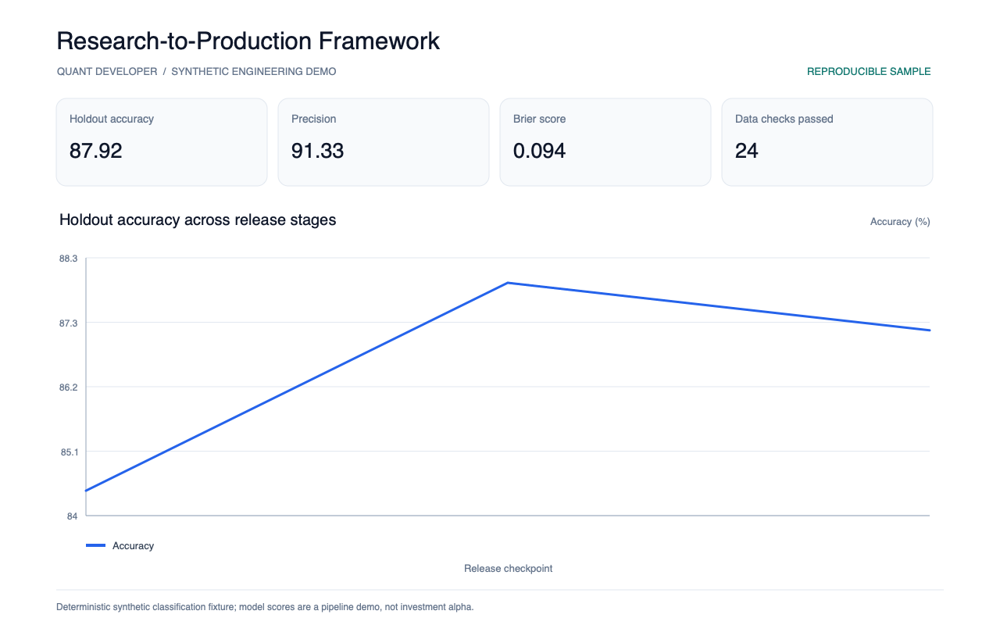
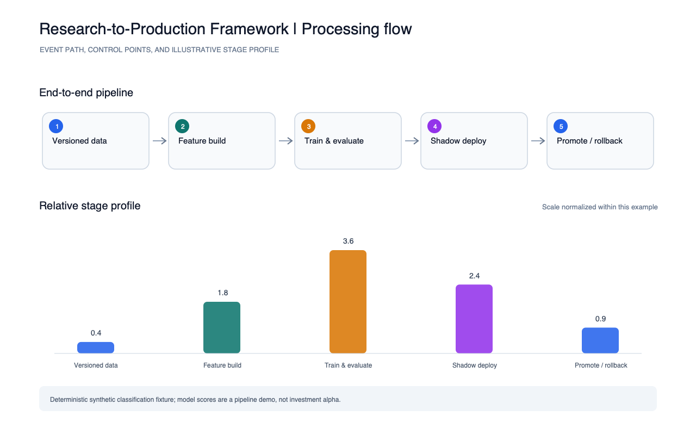

# Research-to-Production Framework

A reproducible model-promotion workflow demo with deterministic sample data, data-quality gates, holdout quality metrics, a content hash, shadow status, and a promotion rule.

Run `python3 run.py` to write `reports/metrics.json`.

Run the smoke test with `python3 -m unittest discover -s tests -v`. The report images were generated from these metrics by the portfolio's shared screenshot script.

This is a synthetic classification and deployment-workflow example; it does not demonstrate real investment alpha or production reliability.
